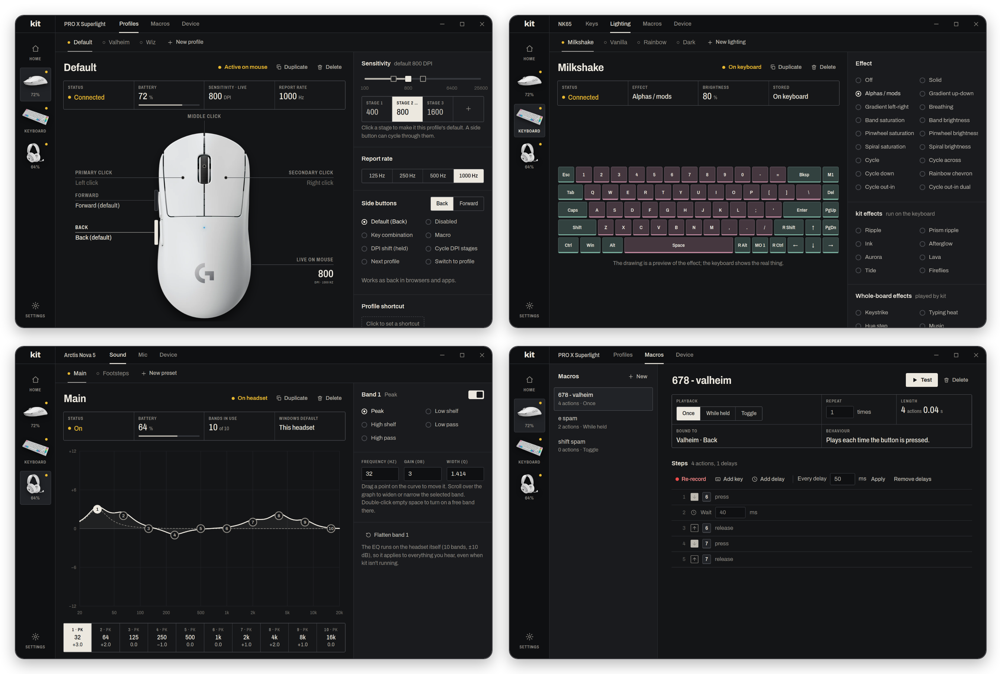
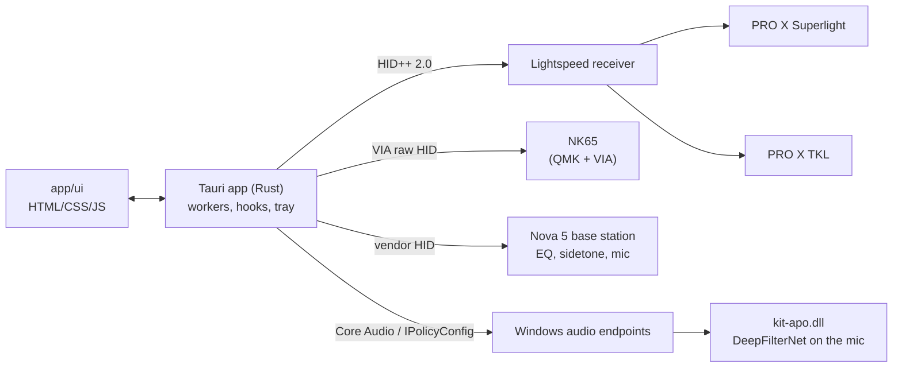

<p align="center">
  
</p>

<h1 align="center">kit</h1>

<p align="center">One small Windows app that replaces Logitech G HUB, SteelSeries GG / Sonar and VIA.</p>

<p align="center">
  
  
  
</p>

kit drives a **Logitech PRO X Superlight** mouse, a **SteelSeries Arctis Nova 5** headset and one of two keyboards,
a **NovelKeys NK65** (VIA firmware) or a **Logitech PRO X TKL LIGHTSPEED**, by speaking each device's own protocol
directly. It exists because the vendor apps are large, run several background services and fight each other over
the same devices; kit uses about 6 MB of memory with its window closed. On first run it asks which of the supported
devices are connected and only shows those.


## Features

Mouse
- Unlimited profiles with DPI stages, polling rate and side-button bindings, switched from the tray, a global
  shortcut per profile, a "next profile" shortcut or a side button.
- Macros recorded with their timing, editable step by step, and played once, while held or as a toggle.
- Side buttons bound to a key combination, a macro, a DPI shift (sniper), DPI cycling or a profile switch.

Keyboard
- NK65: remap any key on every layer (written to the keyboard, so it works on any computer), lighting effects, colors,
  brightness, speed and indicator lights with a live preview, and saved lighting presets switchable from the tray.
- A custom NK65 firmware (QMK with VIA) with per-key effects that run on the keyboard itself: Ripple, Prism ripple,
  Ink, Afterglow, Aurora, Lava, Tide and Fireflies, plus QMK's splash and reactive effects. kit backs up the keymap
  and macros before flashing and restores them after. See [docs/nk65-firmware.md](docs/nk65-firmware.md).
- Whole-board effects that kit plays on any firmware while it runs: Keystrike, Typing heat, Hue step, Music (pulses
  with what's playing), Heartbeat, Candle and Color drift.
- Macros on an NK65 key either stored on the keyboard (keys and waits; works without kit) or run through kit (clicks,
  hold-to-repeat and toggle, via spare F13–F24 codes). Macros created in VIA are listed and can be copied into kit.
- PRO X TKL: lighting effects, per-key painting, battery, lights off when typing stops, and per-key macros or key
  combinations while kit runs.

Headset
- A 10-band parametric EQ with a draggable curve, stored and applied on the headset itself, so it covers every app
  with no virtual audio device and keeps working when kit isn't running.
- A bass slider that adds a low shelf on top of whichever EQ preset is active.
- DeepFilterNet 3 microphone noise suppression installed on the real "Headset Microphone" endpoint, so every app gets
  the clean signal.
- Keeps the headset as the default playback and recording device whenever it reconnects.
- Mic volume, sidetone, mute light, auto-off, volume limiter and battery.

<p align="center">
  
</p>

## Install

Download `kit_x.y.z_x64-setup.exe` from [Releases](https://github.com/anthonyradke/kit/releases) and run it. On first
launch, pick the connected devices and their colors (changeable later in Settings). Closing the window keeps kit in
the tray; **Quit** in the tray menu exits.

Quit or uninstall G HUB and SteelSeries GG first, and close VIA. G HUB talks to the Logitech devices over the same
channel, Sonar takes over the default audio devices and GG rewrites the headset's settings; the setup screen checks
for all three.

kit checks this repo's releases every few hours. When a new version exists, Settings and the tray menu offer to
update: kit downloads the installer, verifies its signature, installs it and restarts.

## How it works



- Mouse (`crates/hidpp`): Logitech's HID++ 2.0 protocol through the Lightspeed receiver. kit switches the mouse to
  host mode so it can change the polling rate, and re-applies settings whenever the mouse wakes.
- Input: side buttons and macro recording use Windows low-level input hooks. Playback uses `SendInput` with scan codes,
  so it works in games that ignore virtual-key input.
- NK65 (`crates/via`): VIA's raw-HID protocol for the keymap, the onboard macro buffer and lighting values, on both the
  original PCB (wilba's RGB backlight) and rev B (QMK RGB matrix). Per-key color needs RGB-matrix firmware; kit's is in
  `firmware/nk65`. kit's own effects (`keyboard/anim.rs`) set the board to Solid and then stream one color and
  brightness about 30 times a second without saving, so the EEPROM isn't worn. Key presses come from the input hook
  (counted, never recorded) and the music level from the default output's peak meter.
- PRO X TKL: lighting through HID++ features 0x8071 (RGB effects) and 0x8081 (per-key lighting). kit takes the LEDs
  over from the onboard profile while it runs, turns them off when the keyboard reports idle and hands them back on
  Quit.
- Headset (`crates/arctis`): the base station's vendor HID interface, the same one GG uses. Settings, including the
  EQ, are stored on the headset.
- Noise suppression (`crates/apo`): a Windows Audio Processing Object, a DLL the audio engine loads for the Nova 5
  microphone. The DeepFilterNet 3 model runs on its own thread next to the engine's real-time thread and adds about
  50 ms of mic latency. Installing it, or updating it after a new kit version, takes one administrator prompt; it can
  be removed from the Mic page.
- `crates/sysaudio` lists audio endpoints, sets the default device and installs or removes the APO.
- Settings live in `%APPDATA%\com.anthonyradke.kit\` (`app.json`, `mouse.json`, `keyboard.json`, `headset.json`).

## Build from source

Requires Rust (MSVC toolchain) and the Tauri CLI (`cargo install tauri-cli`).

```
cargo build --release -p kit-apo            # once: the installer bundles this DLL
cargo build -p kit && target\debug\kit.exe  # run the app (debug)
cd app/src-tauri && cargo tauri build       # release exe + installer (needs the updater signing key)
cargo test                                  # unit tests (VIA codes and macros, EQ and lighting config, denoise)
cargo run -p mouse-probe                    # mouse hardware test: device info
cargo run -p mouse-probe -- dpi 800         # set DPI directly
cargo run -p mouse-probe -- keyboard        # Logitech keyboard: features, lighting zones and effects
cargo run -p headset-probe                  # headset hardware test: status, EQ, settings
cargo run -p headset-probe -- devices       # audio endpoints and defaults
```

`scripts/ui-preview.sh` serves the UI in a normal browser against a fake backend (`scripts/ui-mock.js`), for UI work
on a machine without the devices.

Releases are built by GitHub Actions (`.github/workflows/release.yml`). `scripts/release.sh X.Y.Z` takes the list in
`UNRELEASED.md` as the release notes, bumps the version, tags and pushes; CI builds, signs and publishes the
installer, and the in-app updater shows the notes.

## Layout

| Path | Contents |
|---|---|
| `crates/hidpp`, `crates/mouse-probe` | Logitech HID++ (mouse and keyboard) and its CLI test tool |
| `crates/via` | The NK65's VIA protocol, onboard macro format and key-code tables |
| `crates/arctis`, `crates/headset-probe` | Nova 5 protocol and its CLI test tool |
| `crates/apo`, `crates/sysaudio` | Microphone APO with DeepFilterNet, Windows audio endpoints |
| `app/src-tauri` | The app: `src/mouse` (worker, input hooks, macro player, hotkeys), `src/keyboard` (both keyboards, lighting presets, bindings), `src/headset` (HID worker, endpoint watcher, APO installer), `src/setup.rs`, `src/tray.rs` |
| `app/ui` | The window, plain HTML/CSS/JS with no build step |
| `firmware/nk65` | kit's QMK firmware for the NK65 |
| `scripts` | UI preview, release, screenshots, synthetic input, app icon |

## Known limitations

- Windows only, and only the devices listed above. Other Logitech or SteelSeries hardware isn't detected.
- G HUB, GG/Sonar and VIA can't run at the same time as kit.
- Macros that click, repeat while held or toggle need kit running; only key-and-wait macros can be stored on the NK65.
- kit's whole-board effects and PRO X TKL key bindings only run while kit is running; the NK65's own firmware effects
  don't need it.
- Per-key NK65 color needs RGB-matrix firmware (rev B, or kit's firmware).

## Credits and license

Noise suppression uses [DeepFilterNet](https://github.com/Rikorose/DeepFilterNet) and its published model (MIT or
Apache-2.0). Headset protocol notes are based on [HeadsetControl](https://github.com/Sapd/HeadsetControl), keyboard
lighting on [Solaar](https://github.com/pwr-Solaar/Solaar) and the NK65's VIA definitions on
[the-via/keyboards](https://github.com/the-via/keyboards). Product photos are Logitech's, SteelSeries' and Oblotzky
Industries' own (the NK65 photo with its background removed). The Archivo typeface is under the SIL Open Font License
(`app/ui/fonts/OFL.txt`).

kit is MIT licensed. See [LICENSE](LICENSE).
