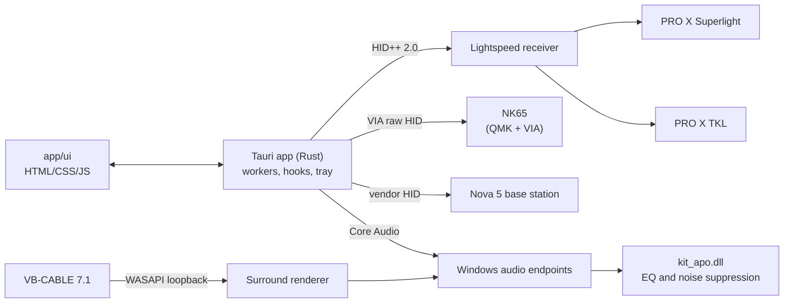

<p align="center">
  
</p>

<h1 align="center">kit</h1>

<p align="center">A single Windows app in place of Logitech G HUB, SteelSeries GG and VIA.</p>

<p align="center">
  
  
  
</p>

kit configures a mouse, a keyboard and a headset by speaking each device's own protocol, with no vendor software
installed. The vendor apps run several background services each and contend for the same devices; kit is one tray
process that uses about 6 MB of memory with its window closed.


## Supported devices

| Device | Connection | Protocol | What kit controls |
|---|---|---|---|
| Logitech PRO X Superlight | Lightspeed receiver | HID++ 2.0 | Profiles, DPI, polling rate, buttons, macros |
| Logitech PRO X TKL LIGHTSPEED | Lightspeed receiver | HID++ 2.0 | Lighting, per-key color, key bindings, battery |
| NovelKeys NK65 | USB | VIA raw HID | Keymaps, lighting, macros, firmware |
| SteelSeries Arctis Nova 5 | Base station | Vendor HID | EQ, surround, microphone, sidetone, battery |

Other hardware isn't detected. On first run kit asks which of these are connected and shows only those.

## Features

Mouse
- Unlimited profiles, each with DPI stages, polling rate and side-button bindings.
- Profiles switch from the tray, a global shortcut or a side button.
- Macros recorded with their timing, editable step by step, played once, while held or as a toggle.
- Side buttons bind to a key combination, a macro, a DPI shift, DPI cycling, a profile switch or nothing.

Keyboard
- NK65 key profiles: full keymaps including the Fn layer. The active one is written to the keyboard, so it works
  on any computer.
- NK65 lighting: effects, colors, brightness and speed with a live preview, saved as presets.
- An optional NK65 firmware (QMK with VIA) adds eight per-key effects that run on the keyboard. kit keeps the
  keymap and macros across a flash. See [docs/nk65-firmware.md](docs/nk65-firmware.md).
- Seven whole-board effects that kit plays on any firmware, including ones that react to typing and to music.
- Macros stored on the NK65 (keys and waits) or run through kit (clicks, hold-to-repeat, toggle).
- PRO X TKL: lighting effects, per-key painting, and per-key macros or key combinations.
- NK65 lights go out while the PC is locked, asleep or has its displays off.

Headset
- A 10-band parametric EQ with a draggable curve, stored on the headset, so it applies to every app and keeps
  working when kit isn't running.
- Optionally the EQ runs on the PC instead, reproducing SteelSeries Sonar's filters to within 0.1 dB from 20 Hz to
  20 kHz at 48 kHz without a virtual audio device. See [docs/sonar-eq.md](docs/sonar-eq.md).
- Optional virtual 7.1 surround rendered from measured dummy-head and room responses.
- DeepFilterNet 3 noise suppression on the headset's microphone endpoint, so every app receives the clean signal.
- A mic test with recorded or live playback, after noise suppression.
- Mic volume, sidetone, mute light, auto-off, volume limiter and battery.
- The ChatMix dial balances chat apps against everything else.
- Settings shows how the audio effects run and repairs them after a driver update.
- The headset is restored as the default playback and recording device whenever it reconnects.

App
- The tray icon warns when a device that isn't charging drops to 15% battery.
- All settings export to and import from one JSON file. kit saves the previous settings before an import.
- A log file, and a diagnostics file from Settings for reporting a problem.
- Signed updates from this repo's releases, installed from Settings or the tray.

<p align="center">
  
</p>

## Requirements

- Windows 11, x64. Windows 10 is untested.
- At least one of the supported devices.
- G HUB, SteelSeries GG and VIA closed or uninstalled. They use the same device channels and audio endpoints. The
  setup screen checks for G HUB and GG and reminds you about VIA.
- For surround only: [VB-CABLE](https://vb-audio.com/Cable/).

## Install

Download `kit_x.y.z_x64-setup.exe` from [Releases](https://github.com/anthonyradke/kit/releases) and run it. Pick the
connected devices on first launch. Closing the window keeps kit in the tray; Quit in the tray menu exits.

Noise suppression and the PC-side EQ install an audio processing object, which takes one administrator prompt.

## How it works



Each device has a worker thread that owns its HID handle. The UI is plain HTML, CSS and JavaScript in the system
WebView, with no build step.

- Settings are stored on the device wherever it supports that (active keymap, headset EQ), so they hold without
  kit running. The mouse runs in host mode; kit re-applies its DPI and rate when it wakes.
- Effects that kit animates are streamed to the keyboard about 30 times a second without saving, so the EEPROM
  isn't worn and a power cut restores the stored lighting.
- The EQ and noise suppression are Windows Audio Processing Objects in one DLL, loaded by the audio engine on the
  headset's own endpoints. Noise suppression adds about 50 ms of microphone latency.
- Surround convolves each of the eight channels with a Neumann KU100 response for that speaker's direction. It
  adds about 40 ms and uses about 1.5% of one CPU core.

[docs/architecture.md](docs/architecture.md) covers each subsystem in detail.

## Build from source

Requires Rust (MSVC toolchain) and the Tauri CLI (`cargo install tauri-cli`).

```sh
cargo build --release -p kit-apo         # the audio DLL the installer bundles
cargo build -p kit                       # the app, debug
cargo test                               # unit tests
cd app/src-tauri && cargo tauri build    # release installer (needs the updater signing key)
```

`scripts/ui-preview.sh` serves the UI in a browser against a mock backend, for work without the devices. The
hardware probe tools and the release process are described in [docs/development.md](docs/development.md).

## Layout

| Path | Contents |
|---|---|
| `crates/hidpp` | Logitech HID++ 2.0, mouse and keyboard |
| `crates/via` | VIA protocol, onboard macro format, key-code tables |
| `crates/arctis` | Arctis Nova 5 protocol |
| `crates/eq`, `crates/apo` | EQ filter design, and the APO DLL for EQ and noise suppression |
| `crates/spatial` | Surround renderer and its filter data |
| `crates/sysaudio` | Windows audio endpoints, default devices, streams |
| `crates/mouse-probe`, `crates/headset-probe` | Command-line hardware test tools |
| `app/src-tauri` | The app: device workers, input hooks, tray, updater |
| `app/ui` | The window |
| `firmware/nk65` | QMK firmware for the NK65 |

## Known limitations

- Windows only, and only the devices listed above.
- G HUB, GG and VIA can't run at the same time as kit.
- Macros that click, repeat or toggle, kit's own lighting effects and PRO X TKL key bindings need kit running.
- Per-key NK65 color needs RGB-matrix firmware (PCB rev B, or kit's firmware).
- Surround routes audio through kit. If kit exits unexpectedly, select the headset in Windows sound settings.
  Games must output 5.1 or 7.1 for rear channels.

## Credits

- [DeepFilterNet](https://github.com/Rikorose/DeepFilterNet) for noise suppression (MIT or Apache-2.0).
- [SADIE II database](https://www.york.ac.uk/sadie-project/database.html), University of York, for the surround
  filters (Apache-2.0; see `crates/spatial/data/NOTICE`).
- [HeadsetControl](https://github.com/Sapd/HeadsetControl), [Solaar](https://github.com/pwr-Solaar/Solaar) and
  [the-via/keyboards](https://github.com/the-via/keyboards) for protocol references.
- Product photos belong to Logitech, SteelSeries and Oblotzky Industries. Archivo is under the SIL Open Font
  License.

## License

MIT. See [LICENSE](LICENSE).
