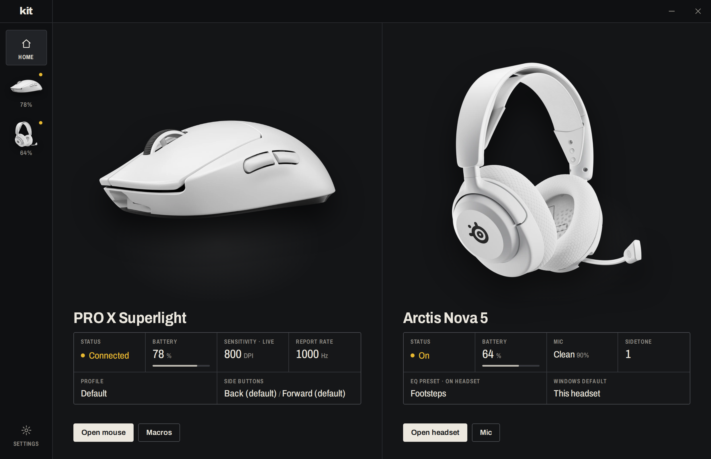

# kit

One small, fast app that replaces Logitech G HUB, SteelSeries GG / Sonar and VIA on Windows, built for a
**Logitech PRO X Superlight** mouse (white or black), a **SteelSeries Arctis Nova 5** headset (white or black) and
one of two keyboards: a **NovelKeys NK65** (VIA firmware, such as the Milkshake Edition) or a
**Logitech PRO X TKL LIGHTSPEED**. On first run it asks which of these are on the PC and only shows those.



**Mouse**
- **Unlimited profiles**: DPI stages, polling rate and side-button bindings per profile
- **Instant switching** from the tray menu, a global shortcut per profile, a "next profile" shortcut, or a side button
- **Macros**: record keys and clicks with their timing, edit the steps, and play them once, while held, or as a toggle
- **Side buttons** can be a key combination, a macro, a DPI shift (sniper), DPI cycling, or a profile switch

**Keyboard**
- On the NK65, remap any key on every layer (written to the keyboard, so it works on any computer), lighting
  effects, colors, brightness, speed and indicator lights with a live preview, and saved lighting presets you can
  switch from the tray (VIA can't save presets)
- Put kit's recorded macros on an NK65 key either *on the keyboard* (works without kit; keys and
  waits only) or *through kit* (clicks, hold-to-repeat and toggle; uses spare F13-F24 codes). Macros you made in
  VIA show up and can be copied into kit
- On the PRO X TKL, lighting effects and per-key painting, battery, lights that turn off when you stop typing, and
  any key can run a macro or a key combination while kit runs

**Headset**
- **EQ on the headset**: 10-band parametric EQ with a draggable curve. It runs on the headset itself, so it applies to
  everything you hear, with no virtual audio devices and nothing to break when kit isn't running
- **Mic noise suppression** (RNNoise) installed straight onto the real "Headset Microphone": every app gets the clean mic
- **Keeps the headset as your default device** whenever it reconnects
- Mic volume, sidetone, mute light, auto-off, volume limiter, battery

**All of them**: one tray icon for profiles, lighting, EQ presets and noise suppression; about 6 MB of memory when
the window is closed.

> Quit (or uninstall) **G HUB** and **SteelSeries GG**, and close VIA. G HUB talks to the Logitech devices over the
> same channel; Sonar takes over your default audio devices and GG rewrites the headset's settings. The setup
> screen checks for them.

## Install

Download `kit_x.y.z_x64-setup.exe` from [Releases](https://github.com/anthonyradke/kit/releases) and run it.
The first time it opens, pick your devices and their colors; you can change them later in Settings.
Closing the window keeps kit running in the tray. Use **Quit** from the tray menu to exit.
kit checks this repo's releases for a new version every few hours. When there is one, Settings and the tray menu
offer to update; kit downloads the installer, checks its signature, installs it and restarts.
Settings from lightswitch and headroom (the two apps kit replaced) are copied over the first time it runs.

## How it works

- `crates/hidpp` controls the mouse over Logitech's HID++ 2.0 protocol through the Lightspeed receiver. kit puts the
  mouse in *host mode* so it can change the polling rate, and re-applies your settings whenever the mouse wakes.
- Side buttons and macro recording use Windows low-level input hooks. Playback uses `SendInput` with scan codes,
  so it works in games that ignore virtual-key input.
- The NK65 is driven through VIA's own raw-HID protocol (`crates/via`): keymap, the onboard macro buffer and
  lighting values, for both the original PCB (wilba's RGB backlight) and rev B (QMK RGB matrix). Per-key colors
  need custom firmware; the plan is in [docs/nk65-firmware.md](docs/nk65-firmware.md).
- The PRO X TKL's lighting goes through HID++ (RGB effects 0x8071, per-key lighting 0x8081). kit takes the LEDs
  over from the onboard profile while it runs, turns them off when the keyboard reports idle, and hands them back
  on Quit. Its key bindings, like the mouse side buttons, use a low-level input hook.
- `crates/arctis` talks to the headset's base station over HID (the vendor interface GG uses). Settings, including the
  EQ, are stored on the headset.
- `crates/apo` is a Windows Audio Processing Object: a DLL the Windows audio engine loads for the Nova 5 microphone.
  Installing it needs one administrator prompt; it can be removed from the Mic page.
- `crates/sysaudio` lists audio endpoints, sets the default device, and installs/removes the APO.
- Settings live in `%APPDATA%\com.anthonyradke.kit\` (`app.json` for the device list, `mouse.json` with the
  macros, `keyboard.json`, `headset.json`).

## Build from source

Requires Rust (MSVC toolchain) and the Tauri CLI (`cargo install tauri-cli`).

```
cargo build --release -p kit-apo            # once: the installer bundles this DLL
cargo build -p kit && target\debug\kit.exe  # run the app (debug)
cd app/src-tauri && cargo tauri build       # release exe + installer in target/release/bundle (needs the signing key)
cargo run -p mouse-probe                    # mouse hardware test: device info
cargo run -p mouse-probe -- dpi 800         # set DPI directly
cargo run -p mouse-probe -- keyboard        # Logitech keyboard: features, lighting zones and effects
cargo run -p headset-probe                  # headset hardware test: status, EQ, settings
cargo run -p headset-probe -- devices       # audio endpoints and defaults
```

Releases are built by GitHub Actions (`.github/workflows/release.yml`): bump the version in
`app/src-tauri/tauri.conf.json` and `app/src-tauri/Cargo.toml`, then push an annotated tag such as `v0.2.1`. The tag's
message becomes the release notes that kit shows next to the update.

## Layout

- `crates/hidpp`, `crates/mouse-probe`: Logitech protocol (mouse and keyboard) and its CLI test tool
- `crates/via`: the NK65's VIA protocol, onboard macro format and key-code tables
- `crates/arctis`, `crates/apo`, `crates/sysaudio`, `crates/headset-probe`: headset protocol, mic APO, Windows audio, CLI
- `app/src-tauri`: the app. `src/mouse` (device worker, input hooks, macro player, hotkeys), `src/keyboard`
  (worker for both keyboards, lighting presets, key bindings), `src/headset` (HID worker, audio endpoint watcher,
  APO installer), `src/setup.rs` (device list), `src/tray.rs`, `src/main.rs`
- `app/ui`: the window (plain HTML/CSS/JS, no build step)
- `scripts`: dev helpers for screenshots, synthetic input and the app icon

Headset protocol notes are based on [HeadsetControl](https://github.com/Sapd/HeadsetControl), keyboard lighting
on [Solaar](https://github.com/pwr-Solaar/Solaar) and the NK65's VIA definitions on
[the-via/keyboards](https://github.com/the-via/keyboards). Product photos are Logitech's, SteelSeries' and Oblotzky
Industries' own (the NK65 photo with its background removed). The Archivo typeface is under the SIL Open Font License (`app/ui/fonts/OFL.txt`).
